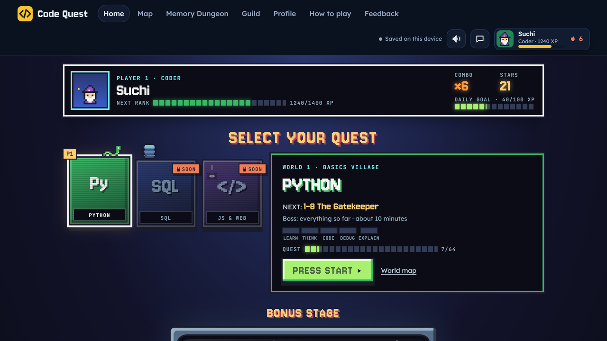
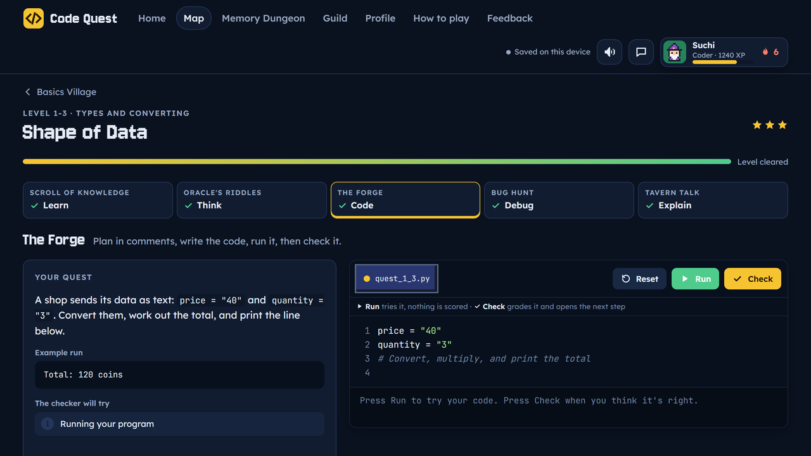
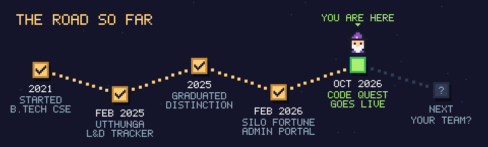

Hi, I'm Suchi, a developer.

A while back someone asked me to explain a piece of code I had written. I couldn't. I'd followed the tutorials and it ran, but I didn't really understand what I'd made.

So now I'm building **[Code Quest](https://codequest-game.thenameissuchi.workers.dev)**, a pixel-art game where you learn Python by doing it, not by watching it. Each level takes about 10 minutes and has five steps:

| Step | What you do |
|---|---|
| **Learn** | Read a short lesson with examples you can run |
| **Think** | Guess what the code prints before you run it |
| **Code** | Write it yourself. It's checked against real test cases |
| **Debug** | Fix someone else's broken code |
| **Explain** | Say what it does in your own words |

The last step is the one I needed most.

  
  

  <a href="https://codequest-game.thenameissuchi.workers.dev"><b>Play the first level</b></a>. It's free, and you can try it without signing up.

<b>How it's built</b>

 

- Plain HTML, CSS and JavaScript, no framework. A small Node script bundles it all into one page.
- Your Python runs right in the browser with Skulpt, so there's no server running anyone's code.
- Supabase (PostgreSQL) stores accounts, saves, guilds and guild chat. Row-level security means each player can only read and change their own data.
- You can sign in with Google, or play as a guest first and link Google later without losing progress.
- Hosted on a Cloudflare Worker, which redeploys on every push.
- 1,388 automatic checks run before every release, so no level ships with a broken answer.
- I build with AI tools as a pair programmer, and I'm working through every part until I can explain it myself. That's the whole point of the game, after all.

The source is private for now. [Pyworld](https://github.com/S9-nine/Pyworld) is the first public version.

 

#### Silo Fortune · Feb to May 2026

Built an admin portal in React and Django with three access levels: Super Admin, Admin and User. Permissions are checked on the server too, not just hidden in the UI.

#### Utthunga Technologies · Feb to Apr 2025

Built a tracker in Angular and Django for employee training, attendance and assessment scores, with Excel import and export for bulk records.

### Other things I've made

- **[Gau Sampurna](https://github.com/S9-nine/Gausampurna)**: a mobile-first shop for a cattle nutrition brand (React, Vite, Tailwind)
- **[LinguaSwift](https://github.com/S9-nine/Vibe-Translate-)**: type in English and watch it turn into Kannada or Hindi as you type, with read-aloud
- **[Pyworld](https://github.com/S9-nine/Pyworld)**: where Code Quest started

### What I work with

Python · JavaScript · SQL · HTML and CSS · Django · React · Angular · PostgreSQL · Supabase · Cloudflare · Git

### Right now

- Play data showed most new players stop at level 1-2, so I'm rewriting it to be gentler.
- Getting better at explaining my own code. Yes, I see the irony.

---

I'm open to junior developer roles. Say hi at [thenameissuchi@gmail.com](mailto:thenameissuchi@gmail.com) or on [LinkedIn](https://www.linkedin.com/in/sucharithbiswas/).
